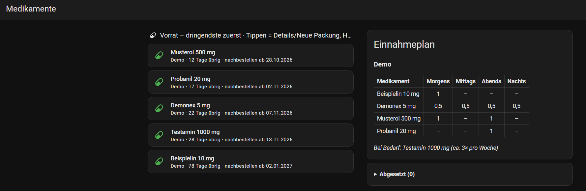
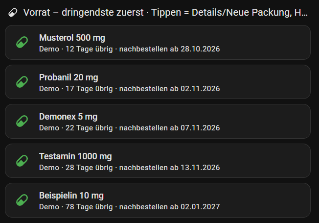
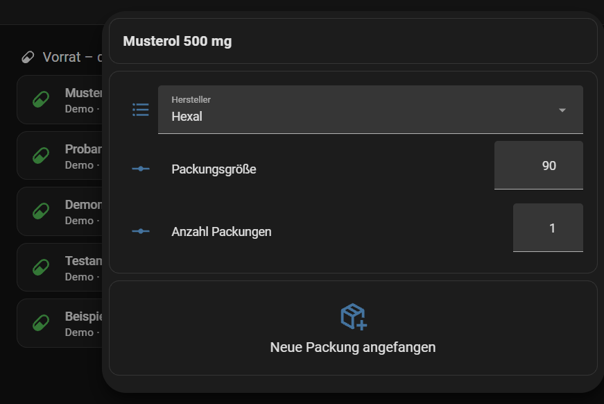
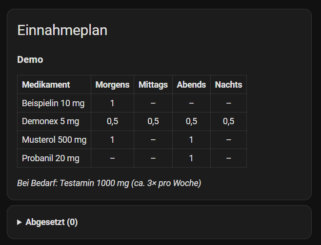

# Medikamentenplan

Home-Assistant-Custom-Integration: Medikamentenübersicht je Plan (z. B. je Person) mit Reichweite, Nachbestelldatum und Status (ok / nachbestellen / aufgebraucht / abgesetzt). Nur Übersicht, keine Erinnerungen. Alle Daten bleiben lokal im HA-Store (`.storage/medikamentenplan.<entry_id>`), es gibt keine Cloud und keine Internet-Abfrage.

## Installation

**HACS:** Custom repository `https://github.com/ChristianV1977/ha-medikamentenplan`, Kategorie "Integration", dann installieren und HA neu starten.
**Manuell:** `custom_components/medikamentenplan` nach `<config>/custom_components/` kopieren, HA neu starten.
Danach: Einstellungen > Geräte & Dienste > Integration hinzufügen > "Medikamentenplan" (ein Eintrag je Plan, Name frei wählbar). Medikamente pflegst du über "Konfigurieren".

## Bedienung (Menü "Konfigurieren")

- **Medikament hinzufügen**, **Aus Startliste wählen** (Wirkstoff, Stärke, Packung, Hersteller), **Aus Katalog übernehmen** (Vorlage aus bestehenden Einträgen)
- **Neue Packung angefangen:** Medikament wählen, dann fragt ein Formular Hersteller und Packungsgröße ab (mit den bisherigen Werten vorbelegt, bei Änderung überschreiben), dazu Anzahl Packungen und Anbruchdatum (Standard heute). Bestätigen übernimmt die Änderungen und setzt Anbruch und Bestand neu.
- **Bearbeiten**, **Löschen**
- **Absetzen / Reaktivieren:** Medikament mit Häkchen "Abgesetzt" (Datum optional, Standard heute) kennzeichnen; Häkchen entfernen = reaktivieren. Abgesetzte haben Status `abgesetzt`, keine Reichweite und kein Nachbestelldatum (Ampel entfällt), und werden im Dashboard ausgeblendet bzw. im Abschnitt "Abgesetzt" gelistet. "Neue Packung" ist für abgesetzte gesperrt.

Service `medikamentenplan.neue_packung` (Ziel: Reichweite-Sensor): optional `anbruchdatum`, `anzahl_packungen`, `hersteller`, `packungsgroesse`; nicht angegebene Felder bleiben unverändert. Je Medikament gibt es `select.*_hersteller` (Pulldown aus Herstellerkatalog; freie Werte weiter über den Options-Dialog), `number.*_packungsgrosse` und `number.*_anzahl_packungen` (Änderung von Hersteller/Größe wird sofort gespeichert, Anzahl ist nur die Vorgabe für die nächste Packung). Der Button "Neue Packung angefangen" setzt Anbruch = heute und Bestand = Packungsgröße × Anzahl Packungen (danach wieder 1); für Abgesetzte sind die Felder unavailable.

## Dashboard

Beispiel mit auto-entities (HACS) und Mushroom: Vorratskarten über `filter.include` (`integration: medikamentenplan`, `entity_id: sensor.*_reichweite_tage_verbleibend`), abgesetzte per `exclude` mit `attributes: {status: abgesetzt}` ausblenden. Für "Neue Packung" mit Rückfrage Tipp-Aktion `browser_mod.popup` mit den drei Feldern und dem Button verwenden. Für den Einnahmeplan stehen die Attribute `morgens`/`mittags`/`abends`/`nachts` am Reichweite-Sensor bereit.

## Dashboard-Beispiel

Fertige Ansicht (Vorratskarten nach Dringlichkeit, Popup mit Hersteller-Pulldown, Packungsgröße, Anzahl und Button "Neue Packung angefangen", Einnahmeplan-Tabelle): [`examples/dashboard-medikamente.yaml`](examples/dashboard-medikamente.yaml). Im Raw-Konfigurationseditor eines Dashboards einfügen und `PLANNAME` durch den Plan-Namen ersetzen. Für alle Pläne oder einen anderen Plan: `python3 tools/gen_dashboard.py [PLAN]`. Benötigt auto-entities, Mushroom und browser_mod (HACS).

## Screenshots

Demo-Plan mit rein fiktiven Medikamenten.

## Datenschutz

Medikamentendaten sind Gesundheitsdaten. Die Integration setzt alle Attribute auf `_unrecorded_attributes` (kein Verlauf im Recorder), das Geräteregister enthält keinen Hersteller oder Wirkstoff. **Empfohlen:** `sensor.medikament_*`, `button.medikament_*`, `select.medikament_*` und `number.medikament_*` zusätzlich aus Recorder, InfluxDB und Logbuch ausschließen und das Dashboard nur Admins zeigen. Beim Löschen eines Plans wird sein Store entfernt. Das Repo enthält keine echten Daten; die Startliste ist eine eigene Zusammenstellung allgemein bekannter Fakten (keine PZN, keine Preise), **Angaben ohne Gewähr, bitte mit der Packung abgleichen**. Die Integration ersetzt keinen Arzt und keine Apotheke.

## Entwicklung

Tests: `python3 -m venv .venv && .venv/bin/pip install pytest && .venv/bin/python -m pytest tests` (reine Berechnungsfunktionen in `calc.py`). Lizenz: MIT.

## Hinweis zu HACS und GitLab

HACS unterstuetzt nur oeffentliche GitHub-Repositories. Die Entwicklung laeuft auf einer privaten GitLab-Instanz; das GitHub-Repo ist ein Spiegel.
